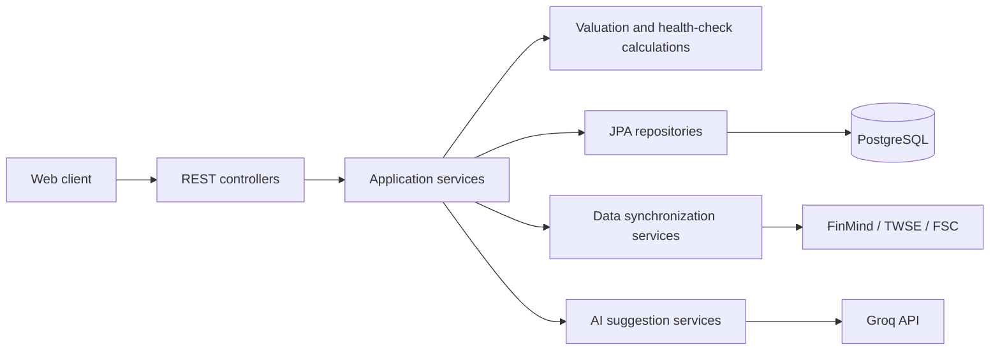

# Stock Analysis Backend

台股分析網站的 REST API，整合估值計算、企業財務體質檢視、股票搜尋與收藏、外部資料更新，以及按需產生的 AI 分析。系統以 Spring Boot 分層架構實作，將 HTTP 介面、應用流程、財務計算、外部資料存取與持久化責任分開。

A REST API for a Taiwan stock analysis website that combines valuation calculations, company financial health checks, stock search and favorites, external data updates, and on-demand AI analysis. The system uses a layered Spring Boot architecture that separates HTTP interfaces, application workflows, financial calculations, external data access, and persistence responsibilities.

搭配的 Angular 前端請參閱 [`stock-analysis-front-end-public`](https://github.com/Adam-Chung/stock-analysis-front-end-public)。

See [`stock-analysis-front-end-public`](https://github.com/Adam-Chung/stock-analysis-front-end-public) for the companion Angular frontend.

## 核心功能

### Key features

- **六段目標價估值**：依歷史 PER／PBR、EPS／BPS、殖利率與近十年價格區間，計算便宜價到爆炸貴等六個價位。<br>
  **Six-tier target-price valuation**: Calculates six price tiers, from cheap to extremely expensive, using historical PER/PBR, EPS/BPS, dividend yield, and the ten-year price range.
- **企業體質檢視**：依一般企業與銀行套用不同財務指標模板，保留季度快照、達標狀態與使用者筆記，支援跨季比較。<br>
  **Company health checks**: Applies separate financial-metric templates to general companies and banks, retains quarterly snapshots, pass/fail status, and user notes, and supports quarter-over-quarter comparison.
- **股價趨勢資料**：提供週 K 線資料，讓前端同時呈現價格趨勢與估值區間。<br>
  **Price-trend data**: Provides weekly candlestick data so the frontend can present price trends alongside valuation ranges.
- **股票搜尋與收藏**：維護股票目錄、搜尋股票、管理收藏清單，並批次更新收藏股票的估值結果。<br>
  **Stock search and favorites**: Maintains the stock directory, supports stock search and favorite-list management, and batch-updates valuation results for favorite stocks.
- **外部資料整合**：整合 FinMind、TWSE 與金融監督管理委員會公開資料，集中處理節流、有限重試、錯誤轉換與資料更新流程。<br>
  **External data integration**: Integrates public data from FinMind, TWSE, and Taiwan's Financial Supervisory Commission, with centralized throttling, bounded retries, error translation, and data-update workflows.
- **按需 AI 分析**：只有在使用者主動觸發時才呼叫 Groq，並保存每支股票最新的估值或企業體質建議，避免頁面載入時重複消耗額度。<br>
  **On-demand AI analysis**: Calls Groq only when explicitly requested by the user and stores the latest valuation or company-health suggestion for each stock, avoiding repeated quota usage during page loads.
- **API 文件與健康檢查**：提供 OpenAPI／Swagger UI 與 Spring Boot Actuator health endpoint。<br>
  **API documentation and health checks**: Provides OpenAPI/Swagger UI and a Spring Boot Actuator health endpoint.

詳細欄位、估值公式、資料來源映射與資料表設計位於 [`docs/spec/`](docs/spec/)。

Detailed fields, valuation formulas, data-source mappings, and database-table designs are documented in [`docs/spec/`](docs/spec/).

## 系統架構

### System architecture



- **Controller**：定義股票、目標價、企業體質、收藏與驗證相關 HTTP API。<br>
  **Controller**: Defines HTTP APIs for stocks, target prices, company health checks, favorites, and authentication.
- **Application Service**：協調資料讀取、更新、估值與 AI 建議等 use case。<br>
  **Application Service**: Coordinates use cases for data retrieval, updates, valuation, and AI suggestions.
- **Domain Calculation**：封裝 PER／PBR 估值、年度聚合及企業體質門檻判斷。<br>
  **Domain Calculation**: Encapsulates PER/PBR valuation, yearly aggregation, and company-health threshold evaluation.
- **Repository**：透過 Spring Data JPA 存取 PostgreSQL；Flyway 管理 schema migration。<br>
  **Repository**: Uses Spring Data JPA to access PostgreSQL, while Flyway manages schema migrations.
- **External Adapter**：將各資料來源的格式、節流、重試及例外處理隔離於核心流程之外。<br>
  **External Adapter**: Isolates provider-specific formats, throttling, retries, and exception handling from the core workflow.

## 主要 API

### Main APIs

| 路徑 / Path | 用途 / Purpose |
|---|---|
| `GET /api/stocks/{stockId}/target-price` | 取得目標價估值與相關市場資料<br>Retrieve target-price valuation and related market data |
| `POST /api/stocks/{stockId}/target-price/refresh` | 更新估值所需資料<br>Refresh the data required for valuation |
| `GET /api/stocks/{stockId}/health-check` | 取得企業體質與季度快照<br>Retrieve company-health results and quarterly snapshots |
| `POST /api/stocks/{stockId}/health-check/external-sync` | 更新企業體質外部資料<br>Synchronize external data used by company health checks |
| `GET /api/stocks/{stockId}/weekly-prices` | 取得週 K 線資料<br>Retrieve weekly candlestick data |
| `GET /api/stocks/search` | 搜尋股票目錄<br>Search the stock directory |
| `/api/favorites` | 管理及批次更新收藏股票<br>Manage and batch-update favorite stocks |

完整介面可在啟動後由 `/swagger-ui.html` 查看。

After starting the service, see `/swagger-ui.html` for the complete API reference.

## 技術棧

### Technology stack

- Java 21、Spring Boot 4.1
- Spring Web MVC、Spring Data JPA、Bean Validation
- PostgreSQL、Flyway
- Maven、JUnit、Testcontainers
- Apache POI、Springdoc OpenAPI

## 本機執行

### Running locally

需求：Java 21、Maven、PostgreSQL。

Requirements: Java 21, Maven, and PostgreSQL.

將 `.env.example` 中的變數設定到自己的安全環境後執行：

Configure the variables shown in `.env.example` in your own secure environment, then run:

```powershell
mvn spring-boot:run
```

執行測試：

Run the tests:

```powershell
mvn test
```

預設服務位址為 `http://localhost:8080`，Swagger UI 位於 `http://localhost:8080/swagger-ui.html`。

The service runs at `http://localhost:8080` by default, with Swagger UI available at `http://localhost:8080/swagger-ui.html`.

## 設定與限制

### Configuration and limitations

- 資料庫密碼、FinMind token 與 Groq API key 必須透過環境變數或 secret storage 注入；`.env.example` 只有示意值。<br>
  Database passwords, FinMind tokens, and Groq API keys must be injected through environment variables or secret storage; `.env.example` contains placeholder values only.
- Simple auth 是單一使用者原型，密碼與 session token 設計不符合 production 安全需求，不應直接暴露於公網。<br>
  Simple auth is a single-user prototype. Its password and session-token design does not meet production security requirements and must not be exposed directly to the public internet.
- AI 建議與財務指標僅供研究參考，不構成投資建議。<br>
  AI suggestions and financial indicators are for research purposes only and do not constitute investment advice.
- 啟用第三方資料來源前，使用者必須自行確認目前的 Terms of Service、API 或資料 License、`robots.txt`、rate limit、attribution、隱私、AI processing 與再散布限制。可公開存取不代表已取得使用授權。<br>
  Before enabling any third-party data source, users must independently verify the current Terms of Service, API or data License, `robots.txt`, rate limits, attribution requirements, privacy obligations, AI-processing terms, and redistribution restrictions. Public accessibility does not imply authorization to use the data.

## 授權條款

### License

本 repository 採用自訂的 [Non-Commercial Personal Use License 1.0](LICENSE)，僅允許個人基於非商業目的下載、執行及私人修改。禁止商業使用、收費代管，以及散布原始或修改後的版本。本專案屬於 source-available software，並非 Open Source software。

This repository uses the custom [Non-Commercial Personal Use License 1.0](LICENSE). It permits individuals to download, run, and privately modify the software only for non-commercial purposes. Commercial use, paid hosting, and distribution of original or modified versions are prohibited. This project is source-available software, not Open Source software.
