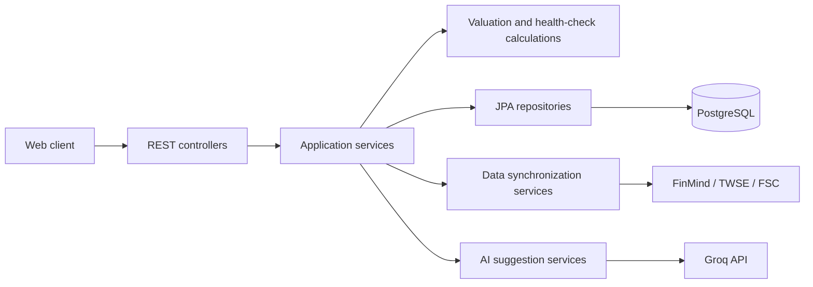

# Stock Analysis Backend

台股分析網站的 REST API，整合估值計算、企業財務體質檢視、股票搜尋與收藏、外部資料更新，以及按需產生的 AI 分析。系統以 Spring Boot 分層架構實作，將 HTTP 介面、應用流程、財務計算、外部資料存取與持久化責任分開。

搭配的 Angular 前端請參閱 [`stock-analysis-front-end-public`](https://github.com/Adam-Chung/stock-analysis-front-end-public)。

## 核心功能

- **六段目標價估值**：依歷史 PER／PBR、EPS／BPS、殖利率與近十年價格區間，計算便宜價到爆炸貴等六個價位。
- **企業體質檢視**：依一般企業與銀行套用不同財務指標模板，保留季度快照、達標狀態與使用者筆記，支援跨季比較。
- **股價趨勢資料**：提供週 K 線資料，讓前端同時呈現價格趨勢與估值區間。
- **股票搜尋與收藏**：維護股票目錄、搜尋股票、管理收藏清單，並批次更新收藏股票的估值結果。
- **外部資料整合**：整合 FinMind、TWSE 與金融監督管理委員會公開資料，集中處理節流、有限重試、錯誤轉換與資料更新流程。
- **按需 AI 分析**：只有在使用者主動觸發時才呼叫 Groq，並保存每支股票最新的估值或企業體質建議，避免頁面載入時重複消耗額度。
- **API 文件與健康檢查**：提供 OpenAPI／Swagger UI 與 Spring Boot Actuator health endpoint。

詳細欄位、估值公式、資料來源映射與資料表設計位於 [`docs/spec/`](docs/spec/)。

## 系統架構



- **Controller**：定義股票、目標價、企業體質、收藏與驗證相關 HTTP API。
- **Application Service**：協調資料讀取、更新、估值與 AI 建議等 use case。
- **Domain Calculation**：封裝 PER／PBR 估值、年度聚合及企業體質門檻判斷。
- **Repository**：透過 Spring Data JPA 存取 PostgreSQL；Flyway 管理 schema migration。
- **External Adapter**：將各資料來源的格式、節流、重試及例外處理隔離於核心流程之外。

## 主要 API

| 路徑 | 用途 |
|---|---|
| `GET /api/stocks/{stockId}/target-price` | 取得目標價估值與相關市場資料 |
| `POST /api/stocks/{stockId}/target-price/refresh` | 更新估值所需資料 |
| `GET /api/stocks/{stockId}/health-check` | 取得企業體質與季度快照 |
| `POST /api/stocks/{stockId}/health-check/external-sync` | 更新企業體質外部資料 |
| `GET /api/stocks/{stockId}/weekly-prices` | 取得週 K 線資料 |
| `GET /api/stocks/search` | 搜尋股票目錄 |
| `/api/favorites` | 管理及批次更新收藏股票 |

完整介面可在啟動後由 `/swagger-ui.html` 查看。

## 技術棧

- Java 21、Spring Boot 4.1
- Spring Web MVC、Spring Data JPA、Bean Validation
- PostgreSQL、Flyway
- Maven、JUnit、Testcontainers
- Apache POI、Springdoc OpenAPI

## 本機執行

需求：Java 21、Maven、PostgreSQL。

將 `.env.example` 中的變數設定到自己的安全環境後執行：

```powershell
mvn spring-boot:run
```

測試：

```powershell
mvn test
```

預設服務位址為 `http://localhost:8080`，Swagger UI 位於 `http://localhost:8080/swagger-ui.html`。

## 設定與限制

- 資料庫密碼、FinMind token 與 Groq API key 必須透過環境變數或 secret storage 注入；`.env.example` 只有示意值。
- Simple auth 是單一使用者原型，密碼與 session token 設計不符合 production 安全需求，不應直接暴露於公網。
- AI 建議與財務指標僅供研究參考，不構成投資建議。
- 啟用第三方資料來源前，使用者必須自行確認目前的 Terms of Service、API 或資料 License、robots.txt、rate limit、attribution、隱私、AI processing 與再散布限制。可公開存取不代表已取得使用授權。

## License

本 repository 採用自訂的 [Non-Commercial Personal Use License 1.0](LICENSE)，僅允許個人基於非商業目的下載、執行及私人修改。禁止商業使用、收費代管，以及散布原始或修改後的版本。本專案屬於 source-available software，並非 Open Source software。
